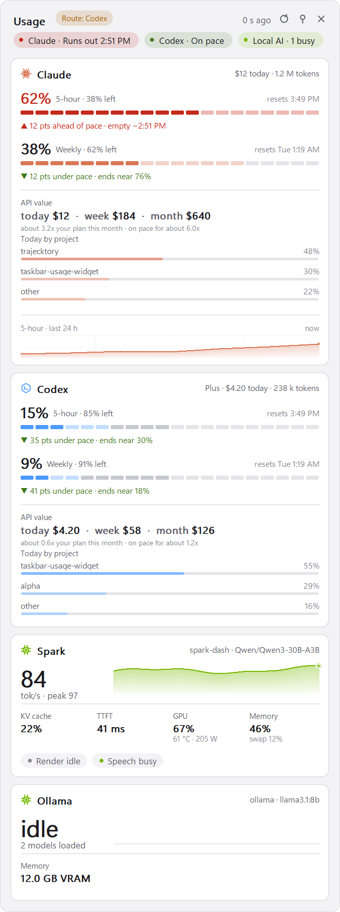

# Taskbar Usage Widget

Claude and Codex limits, plus your local AI servers, live in the Windows 11 taskbar.

A fork of [Claude Usage Widget for Windows Taskbar](https://github.com/AbdoSarmini/claude-usage-widget-for-windows-taskbar) by Abdo Sarmini, extended with Codex limits, local AI servers, a headroom router and an API value view.

<picture>
  <source media="(prefers-color-scheme: dark)" srcset="docs/taskbar-dark.png">
  
</picture>

<picture>
  <source media="(prefers-color-scheme: dark)" srcset="docs/card-dark.png">
  
</picture>

These images use invented sample data.

### ⬇ [Download taskbar-usage-widget.exe](https://github.com/michaelinghilterra-creator/taskbar-usage-widget/releases/latest/download/taskbar-usage-widget.exe)

It is one file of about 1 MB. There is no installer. Each release lists a SHA-256 checksum.

> **"Windows protected your PC"?** The exe is not code-signed. Click **More info**, then **Run anyway**, or [build it yourself](#build-from-source).

## What makes it different

### Headroom router

Most usage widgets tell you where you are. This one also tells you where to send the next piece of work.

- Each provider is `ok`, `tight`, `out` or `unknown`. Out means 98 percent or more used. Tight means 85 percent or more, or a forecast that fills the window before it resets. Fetch errors count as unknown, never as out.
- The card header shows the route, for example **Route: Codex** when Claude is tight and Codex has room.
- The optional Claude Code hook adds one factual line to Claude Code's context when Claude turns tight or out, or recovers. It speaks at most every 30 minutes, stays silent otherwise, and never blocks a prompt. MCP tools let Claude Code ask for headroom and which worker to use.

### API value and burn

The widget prices your local Claude Code and Codex logs at API rates by model and token type. It shows API-equivalent dollars for today, this week and this month, the monthly value as a multiple of your plan price, and the projects that used it today; set plan prices from **Plan prices...** in the right-click menu. Pricing comes from a dated table built into the app at `src/pricing.json`, and you can override it with `pricing.json` in `%LOCALAPPDATA%\TaskbarUsageWidget\`. These numbers estimate what the same usage would cost on the API; they are not a bill.

### Local AI servers

The widget supports spark-dash, SGLang, vLLM, llama.cpp, Ollama, and LM Studio or another OpenAI-compatible models endpoint. Depending on the server, it shows throughput, running and waiting requests, KV cache use, time to first token, loaded models and memory; you can configure several named servers, and `auto` detects the type. spark-dash is one adapter for a DGX Spark running a small stats service, and it is not required for other server types.

Right-click the widget and choose **Local AI servers...**. Enter one `name|url|type` line per server, for example:

```text
Fast|http://gpu-box.local:8000|auto
Chat|http://10.0.0.5:11434|ollama
```

Valid types: `auto`, `spark-dash`, `sglang`, `vllm`, `llamacpp`, `ollama`, `lmstudio`.

## Everything else it shows

- All Claude windows, including 5-hour, weekly and per-model weekly limits, plus Codex windows.
- Pace markers, percentage-point pace lines and "ends near" forecasts.
- A 24 h history chart.
- Alert toasts when a window is at least 90 percent used and forecast to fill before reset, when that high window refills, and when the first local server goes down or comes back.
- Automatic light and dark themes, plus multiple Claude accounts.
- A customizable strip. Choose providers, the local server shown, used or remaining values, font and icon size, icon style, rings, labels, percent signs, visible limits, taskbar side and accounts per column.

## Requirements

- Windows 11.
- For Claude, [Claude Code](https://code.claude.com/docs/en/setup) signed in with a Claude subscription. Run `claude` once and sign in. It does not need to stay open. API keys and the Claude desktop app or claude.ai alone are not supported.
- For live Codex limits, Codex CLI signed in with ChatGPT. Run `codex` once and sign in. An API-key login is not used for the live usage request, so the widget falls back to rate-limit data in local Codex session logs when available.
- Local AI servers are optional.

## Install

1. Put `taskbar-usage-widget.exe` somewhere permanent, such as `%LOCALAPPDATA%\Programs\TaskbarUsageWidget\`.
2. Double-click it. The widget appears beside the tray icons.
3. Right-click it and tick **Start with Windows**.

## Usage

- Hover over the strip for a non-activating preview.
- Click the strip to open the focused details card. Close it by clicking the strip again, pressing **Esc**, using the close button, or clicking outside it. Pin the card to keep it open when focus changes.
- Click a provider heading in the card to open its usage page. A local AI heading opens that server's configured URL.
- Right-click for **Show Claude**, **Show Codex**, **Show local AI**, **Show in taskbar**, **Alerts**, **Local AI servers...**, **Plan prices...**, **Update every**, **Customize**, **Accounts**, **Start with Windows**, **Refresh now**, **Open usage page**, **Connect to Claude Code...** and **Exit**.

### Multiple accounts

If another Claude Code login uses a different config folder, such as `CLAUDE_CONFIG_DIR=%USERPROFILE%\.claude-work`, choose **Accounts**, then **Add account...**, and select that folder. Each account gets its own row.

## Claude Code integration (optional)

Add the widget as an MCP server:

```text
claude mcp add --scope user usage-widget -- "C:\path\taskbar-usage-widget.exe" --mcp
```

<table>
  <thead><tr><th>Tool</th><th>Arguments</th><th>Result</th></tr></thead>
  <tbody>
    <tr><td><code>get_usage_headroom</code></td><td>None</td><td>Current Claude and Codex quota headroom, local server status, route and API value.</td></tr>
    <tr><td><code>get_spark_status</code></td><td>None</td><td>Compatibility view of the first configured local AI server.</td></tr>
    <tr><td><code>get_local_servers</code></td><td>None</td><td>Compact status for every configured local AI server.</td></tr>
    <tr><td><code>recommend_worker</code></td><td><code>task_size</code>: <code>small</code>, <code>medium</code> or <code>large</code>, default <code>medium</code></td><td>A recommended worker with the reason and provider states.</td></tr>
  </tbody>
</table>

For brief routing context inside Claude Code, merge this into `%USERPROFILE%\.claude\settings.json`:

```json
{
  "hooks": {
    "UserPromptSubmit": [
      {
        "hooks": [
          {
            "type": "command",
            "command": "C:\\path\\taskbar-usage-widget.exe",
            "args": ["--hook"],
            "timeout": 5
          }
        ]
      }
    ],
    "SessionStart": [
      {
        "matcher": "startup|resume",
        "hooks": [
          {
            "type": "command",
            "command": "C:\\path\\taskbar-usage-widget.exe",
            "args": ["--hook"],
            "timeout": 5
          }
        ]
      }
    ]
  }
}
```

To undo the hook, delete these `UserPromptSubmit` and `SessionStart` entries.

## Privacy

- The widget contacts `api.anthropic.com` for Claude usage, `platform.claude.com` when a Claude token needs refresh, `chatgpt.com` for Codex usage, and only the local server URLs you configure.
- It reads Claude Code project logs and Codex session logs for model names, token counts and project folders. Conversation text is never copied or stored.
- The Codex login is read only. It is never refreshed or written. The Claude Code login is read from its credentials file. When the token is near expiry or rejected, the widget follows Claude Code's refresh flow and atomically writes the refreshed login back to that same file.
- It writes `state.json`, `history.jsonl`, `value.json` and `hook-state.json` under `%LOCALAPPDATA%\TaskbarUsageWidget\`. Settings are stored under `HKEY_CURRENT_USER\Software\TaskbarUsageWidget`.
- Tokens are never logged. There are no analytics and no update checks.

MCP mode reads the widget's local `state.json`, local Codex rollout metadata, and the configured local servers only. It never reads Claude credentials or refreshes Claude tokens, and it labels Claude logins as `account 1`, `account 2`, and so on instead of exposing email addresses or paths.

## Good to know

The Claude and ChatGPT usage endpoints are not published APIs. They can change without notice and break the widget until it is updated.

## Troubleshooting

<table>
  <thead><tr><th>Problem</th><th>Fix</th></tr></thead>
  <tbody>
    <tr><td>Numbers are dimmed and the tooltip says to sign in</td><td>Run <code>claude</code> and sign in again.</td></tr>
    <tr><td>A dash appears instead of numbers</td><td>Check your internet connection, then hover for the error.</td></tr>
    <tr><td>Codex shows a login error</td><td>Run <code>codex</code> once to sign in again.</td></tr>
    <tr><td>A local server shows as down</td><td>Check its URL and type under <strong>Local AI servers...</strong>.</td></tr>
    <tr><td>The widget overlaps app icons</td><td>Make it narrower under <strong>Customize</strong> by hiding labels or the icon, or choosing a smaller font.</td></tr>
    <tr><td>The widget is missing from a second monitor</td><td>Only the main taskbar is supported.</td></tr>
  </tbody>
</table>

## Uninstall

Untick **Start with Windows**, choose **Exit**, and delete the exe. You can also delete `%LOCALAPPDATA%\TaskbarUsageWidget\` and `HKEY_CURRENT_USER\Software\TaskbarUsageWidget`.

## Build from source

You need [Rust](https://rustup.rs/) with the MSVC toolchain and the Windows SDK.

```text
git clone https://github.com/michaelinghilterra-creator/taskbar-usage-widget
cd taskbar-usage-widget
cargo build --release
```

The `--preview <folder>` flag renders the strip and card with invented data as BMP files.

## Disclaimer

This is an unofficial project. It is not affiliated with or endorsed by Anthropic, OpenAI or NVIDIA. Claude is a trademark of Anthropic. Codex and ChatGPT are trademarks of OpenAI. DGX Spark is a trademark of NVIDIA.

## License

[MIT](LICENSE). The original copyright notice is kept in LICENSE.

Based on [Claude Usage Widget for Windows Taskbar](https://github.com/AbdoSarmini/claude-usage-widget-for-windows-taskbar) by Abdo Sarmini, used under the MIT License.
